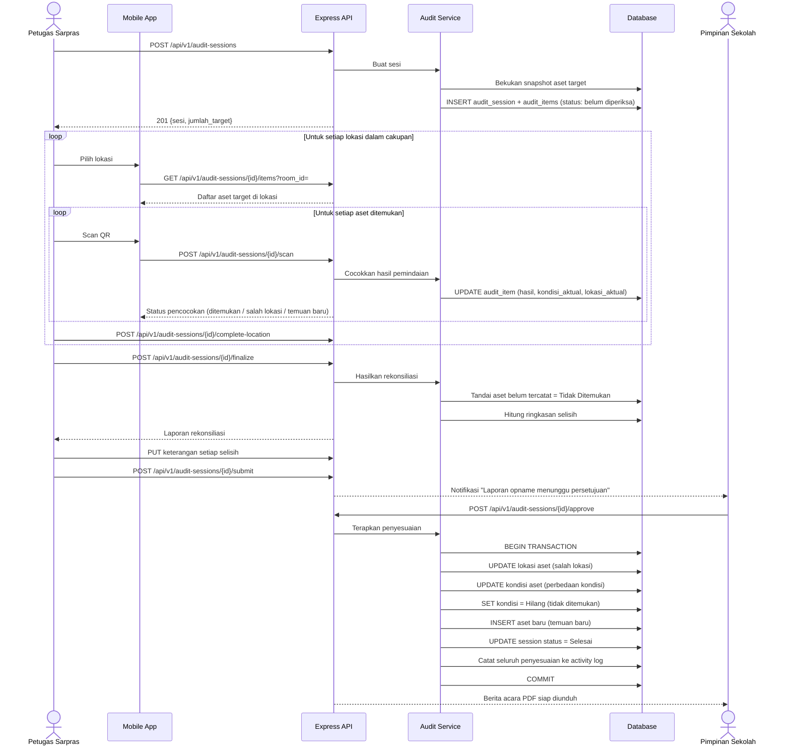
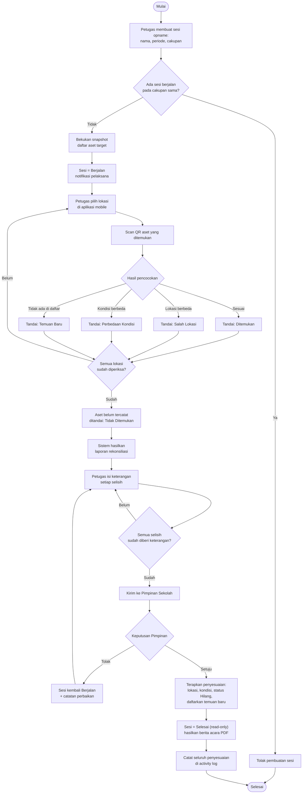

# M-13 — Audit & Stock Opname

> **Modul self-contained.** Seluruh yang diperlukan untuk mengimplementasikan modul ini ada di
> berkas ini: requirement, aturan bisnis, endpoint, entitas, notifikasi, permission, jejak audit,
> dan kriteria penerimaan. Baris yang dimiliki modul lain dirujuk melalui ID, tidak disalin.
>
> Isi requirement bersifat **verbatim dari PRD v1.1**. Sumber kebenaran tunggal.

## 1. Overview

Lihat [`../01-product/overview.md`](../01-product/overview.md) untuk konteks produk menyeluruh.
Modul ini adalah **M-13 — Audit & Stock Opname** sebagaimana terdaftar pada Daftar Modul PRD.

## 2. Scope

Cakupan modul ditentukan oleh Functional Requirement yang tercantum pada bagian 5.
Hal di luar daftar tersebut berada di luar cakupan modul ini.

## 3. Actors

Aktor per requirement tercantum pada tabel **Actor** di tiap FR (bagian 5).
Definisi role: [`../00-foundation/roles-permissions.md`](../00-foundation/roles-permissions.md).

## 4. Business Flow

## 15.7 Stock Opname via Scan QR

---

## 13.3 Process Flow — Stock Opname

## 5. Functional Requirements

### FR-13.1 Membuat Sesi Stock Opname

| Aspek | Uraian |
|---|---|
| **Description** | Membuat sesi pemeriksaan fisik aset dengan cakupan tertentu (seluruh sekolah, per gedung, per ruangan, atau per kategori). |
| **Actor** | Petugas Sarana Prasarana, Administrator |
| **Preconditions** | Terdapat data aset; pengguna memiliki permission `audit.manage` |

**Main Flow**
1. Pengguna membuka menu Audit & Stock Opname dan menekan "Buat Sesi".
2. Pengguna mengisi: nama sesi, periode (tanggal mulai–selesai), cakupan (lokasi dan/atau kategori), serta petugas pelaksana.
3. Sistem membekukan *snapshot* daftar aset yang termasuk cakupan beserta lokasi dan kondisinya saat sesi dibuat.
4. Sistem membuat sesi berstatus `Berjalan` dan menotifikasi petugas pelaksana.

**Alternative Flow**
- **A1 — Sudah ada sesi berjalan pada cakupan yang sama:** Sistem menolak untuk mencegah tumpang tindih.
- **A2 — Cakupan menghasilkan 0 aset:** Sistem menampilkan peringatan dan tidak membuat sesi.

**Post Conditions** — Sesi opname aktif dengan daftar aset target yang telah dibekukan.

**Acceptance Criteria**
- [ ] Snapshot tidak berubah meskipun data aset berubah selama sesi berjalan.
- [ ] Satu aset hanya boleh berada dalam satu sesi opname aktif.
- [ ] Sesi menampilkan progres: jumlah aset diperiksa dari total target.

### FR-13.2 Pelaksanaan Opname via Scan QR

| Aspek | Uraian |
|---|---|
| **Description** | Petugas memeriksa fisik aset di lokasi dengan memindai QR dan mencatat temuan langsung dari aplikasi mobile. |
| **Actor** | Petugas Sarana Prasarana |
| **Preconditions** | Terdapat sesi opname berstatus `Berjalan`; petugas terdaftar sebagai pelaksana |

**Main Flow**
1. Petugas membuka sesi opname aktif pada aplikasi mobile dan memilih lokasi yang akan diperiksa.
2. Sistem menampilkan daftar aset yang seharusnya ada di lokasi tersebut beserta status pemeriksaannya.
3. Petugas memindai QR setiap aset yang ditemukan.
4. Sistem mencocokkan hasil pemindaian dengan daftar target dan menandai aset `Ditemukan`.
5. Petugas menetapkan kondisi fisik aktual dan dapat menambahkan catatan serta foto.
6. Setelah selesai pada satu lokasi, petugas menekan "Selesaikan Lokasi Ini".

**Alternative Flow**
- **A1 — Aset ditemukan di lokasi berbeda dari data sistem:** Sistem menandai `Salah Lokasi` dan menawarkan pembaruan lokasi setelah sesi disetujui.
- **A2 — Aset dalam daftar tidak ditemukan sampai sesi berakhir:** Otomatis ditandai `Tidak Ditemukan` dan masuk daftar selisih.
- **A3 — Ditemukan aset fisik tanpa data di sistem:** Petugas mencatatnya sebagai `Temuan Baru` (deskripsi, kategori perkiraan, kondisi, lokasi, foto) untuk didaftarkan setelah sesi disetujui. **Catatan model data:** temuan baru disimpan pada tabel terpisah `audit_new_findings` yang **tidak** memiliki FK ke `assets`, karena asetnya memang belum ada. `audit_items` tetap ber-FK ke `assets` dan hanya memuat aset yang termasuk snapshot target.
- **A4 — QR rusak/tidak terbaca:** Petugas memasukkan kode aset manual atau memilih dari daftar target.
- **A5 — Kondisi aktual berbeda dari data sistem:** Sistem menandai `Perbedaan Kondisi` dan mencatat kedua nilainya.

**Post Conditions** — Hasil pemeriksaan per aset tercatat pada sesi; progres opname terbarui real-time.

**Acceptance Criteria**
- [ ] Satu aset hanya dapat dicatat satu kali dalam satu sesi; pemindaian ulang menampilkan status yang sudah tercatat.
- [ ] Progres per lokasi dan keseluruhan terlihat real-time.
- [ ] Aset berstatus `Dipinjam` ditandai khusus dan tidak dihitung sebagai selisih bila memang sedang dipinjam.
- [ ] Seluruh alur dapat diselesaikan dari aplikasi mobile.

### FR-13.3 Rekonsiliasi & Penyelesaian Sesi Opname

| Aspek | Uraian |
|---|---|
| **Description** | Membandingkan hasil pemeriksaan fisik dengan data sistem, menghasilkan laporan selisih, dan menerapkan penyesuaian setelah disetujui. |
| **Actor** | Petugas Sarpras (menyusun), Pimpinan Sekolah (menyetujui) |
| **Preconditions** | Seluruh lokasi dalam cakupan sesi telah diperiksa atau periode sesi berakhir |

**Main Flow**
1. Petugas menekan "Selesaikan Sesi".
2. Sistem menghasilkan laporan rekonsiliasi berisi: total aset target, ditemukan sesuai, salah lokasi, perbedaan kondisi, tidak ditemukan, dan temuan baru.
3. Petugas memberi keterangan pada setiap selisih dan mengusulkan tindakan (perbarui lokasi, perbarui kondisi, tetapkan `Hilang`, daftarkan aset baru).
4. Petugas mengirim laporan kepada Pimpinan Sekolah untuk persetujuan.
5. Pimpinan Sekolah meninjau dan menyetujui.
6. Sistem menerapkan seluruh penyesuaian ke data aset dan menutup sesi (`Selesai`).
7. Sistem menghasilkan berita acara stock opname dalam format PDF.

**Alternative Flow**
- **A1 — Pimpinan menolak laporan:** Sesi kembali berstatus `Berjalan` dengan catatan perbaikan.
- **A2 — Terdapat aset `Tidak Ditemukan`:** Sistem mewajibkan keterangan pada setiap aset sebelum laporan dapat dikirim.
- **A3 — Sesi dibatalkan:** Administrator dapat membatalkan sesi; seluruh hasil pemeriksaan tetap tersimpan sebagai arsip tanpa diterapkan ke data aset.

**Post Conditions** — Data aset tersesuaikan dengan kondisi fisik; berita acara tersimpan; sesi tertutup permanen dan hasilnya tidak dapat diubah.

**Acceptance Criteria**
- [ ] Penyesuaian data aset hanya diterapkan setelah persetujuan Pimpinan Sekolah.
- [ ] Setiap penyesuaian tercatat di activity log dengan referensi ke sesi opname.
- [ ] Berita acara memuat identitas sesi, pelaksana, penyetuju, ringkasan selisih, dan tanggal.
- [ ] Sesi yang sudah `Selesai` bersifat *read-only* bagi seluruh role.

### FR-13.4 Sesi Stock Opname Bahan

| Aspek | Uraian |
|---|---|
| **Description** | Memeriksa jumlah fisik bahan di lokasi penyimpanan dan mencocokkannya dengan saldo sistem. Sesi bahan **terpisah** dari sesi aset — satu sesi tidak pernah mencampur kedua domain (`BR-093`). |
| **Actor** | Petugas Sarpras (melaksanakan), Pimpinan Sekolah (menyetujui) |
| **Preconditions** | Terdapat target bahan pada cakupan lokasi sesuai keputusan §6, termasuk saldo nol; pengguna memiliki permission `audit.manage` |

**Main Flow**
1. Pengguna membuat sesi opname dan memilih domain **Bahan** beserta cakupan lokasi penyimpanan.
2. Sistem membekukan *snapshot* saldo sistem tiap bahan pada lokasi yang tercakup.
3. Petugas mencatat **jumlah fisik hasil hitungan** per bahan per lokasi — dapat dibantu pemindaian QR bahan untuk melompat ke barisnya (`BR-090`).
4. Sistem menghitung selisih antara jumlah fisik dan basis saldo saat hitungan; snapshot awal tetap disimpan (§6).
5. Petugas memberi keterangan pada setiap selisih dan mengirim laporan kepada Pimpinan Sekolah.
6. Setelah disetujui, sistem menerbitkan transaksi bahan berjenis `OPNAME` sebesar selisihnya, memperbarui saldo, dan menutup sesi.
7. Sistem menghasilkan berita acara opname bahan dalam format PDF.

**Alternative Flow**
- **A1 — Bahan tercatat 0 tetapi ditemukan fisiknya:** Selisih positif dicatat dan diberi keterangan; saldo bertambah setelah disetujui.
- **A2 — Terdapat selisih tanpa keterangan:** Sistem menolak pengiriman laporan (`BR-095`).
- **A3 — Pimpinan menolak laporan:** Sesi kembali `Berjalan`; saldo **tidak** tersentuh.

**Post Conditions** — Saldo bahan tersesuaikan dengan hasil hitungan fisik melalui transaksi `OPNAME`; berita acara tersimpan; sesi tertutup permanen.

**Acceptance Criteria**
- [ ] Satu sesi opname hanya mencakup satu domain — memilih bahan dan aset sekaligus ditolak.
- [ ] Saldo bahan berubah **hanya** setelah laporan disetujui Pimpinan Sekolah (`BR-094`).
- [ ] Penyesuaian hasil opname tercatat sebagai transaksi bahan berjenis `OPNAME`, bukan sebagai suntingan saldo langsung (`BR-081`).
- [ ] Selisih tanpa keterangan menghalangi pengiriman laporan.

## 6. Business Rules

### Dimiliki modul ini

| Kode | Business Rule |
|---|---|
| BR-054 | Satu aset hanya boleh tercakup dalam satu sesi stock opname **domain Aset** yang berstatus `Berjalan`. |
| BR-055 | Daftar aset target dibekukan sebagai *snapshot* saat sesi dibuat dan tidak berubah selama sesi berjalan. |
| BR-056 | Aset berstatus `Dipinjam` pada saat opname tidak dihitung sebagai selisih. |
| BR-057 | Hasil opname baru diterapkan ke data aset setelah laporan rekonsiliasi disetujui Pimpinan Sekolah. |
| BR-058 | Setiap aset berstatus `Tidak Ditemukan` wajib diberi keterangan sebelum laporan dapat diajukan. |
| BR-059 | Sesi opname yang telah `Selesai` bersifat *read-only* dan tidak dapat diubah oleh role mana pun. |
| BR-093 | Satu sesi stock opname hanya mencakup **satu domain**: Aset atau Bahan. Sesi tidak pernah mencampur keduanya. `BR-054`…`BR-058` berlaku bagi sesi domain **Aset**. |
| BR-094 | Hasil opname bahan baru diterapkan ke saldo setelah laporan rekonsiliasi disetujui Pimpinan Sekolah — sejajar dengan `BR-057` pada sesi aset. |
| BR-095 | Setiap selisih pada sesi opname bahan wajib diberi keterangan sebelum laporan dapat diajukan — sejajar dengan `BR-058` pada sesi aset. |

**Aturan bersama yang juga berlaku** (dimiliki modul lain, dirujuk melalui ID — tidak disalin ke sini):

`BR-012` (m04)

### Keputusan implementasi aset — 14 Oktober 2026

Keputusan berikut dikonfirmasi pengguna melalui AskUserQuestion untuk PR-04-11/12/13/14/19.
Domain Bahan diperluas melalui PR-05-24; ketentuan khususnya tercantum berikut.

- Sesi aktif meliputi Berjalan dan Menunggu Persetujuan. Irisan satu aset snapshot sekalipun
  menolak sesi baru, termasuk irisan antara sekolah, gedung, ruangan dan kategori. Klaim
  dilepas sesudah persetujuan atau pembatalan; snapshot tidak mengikuti perubahan aset.
- Scan serta temuan baru menjadi pengecualian luring pada kebijakan mobile. SQLite menyimpan
  hasil dengan UUID dan foto terkompresi sebelum menampilkan berhasil. Target lokasi, kategori
  serta identitas/izin minimum sesi terakhir yang terverifikasi berlaku maksimal 72 jam per
  akun/sesi. Token tetap di SecureStore; SQLite hanya memuat fingerprint token. Saat restart
  tanpa internet, hanya opname lokal dapat dibuka. Logout menghapus cache/antrean akun.
  Hasil belum diterima server dipertahankan setelah cache kedaluwarsa untuk dikirim setelah
  login diperbarui; tidak ada penghapusan diam-diam hasil pemeriksaan.
- Sinkronisasi otomatis saat daring, foreground atau timer, berurutan dengan UUID/payload
  tetap. Server memeriksa ulang permission dan penugasan. Hasil pertama yang diterima server
  menang; scan berikutnya mengembalikan hasil pertama sebagai duplikat. UUID yang dipakai untuk
  payload berbeda ditolak. Aset terdaftar di luar snapshot tidak menjadi temuan baru.
- Penyelesaian lokasi, finalisasi, pengiriman dan keputusan tetap daring. Finalisasi dapat
  dilakukan sesudah seluruh lokasi selesai atau periode berakhir (WIB). Aset belum dipindai
  dengan unit pinjaman benar-benar belum kembali ditandai Dipinjam, bukan selisih.
- Seluruh selisih wajib keterangan/tindakan. Pengusul meninjau lokasi/kondisi aset terbaru;
  perubahan sesudah tinjauan memblokir persetujuan penyesuaian dan meminta rekonsiliasi ulang,
  tanpa menimpa perubahan operasional. Tidak Ditemukan dapat diusulkan Hilang atau Tanpa
  Penyesuaian dengan alasan; aset yang masih dipinjam tidak boleh ditetapkan Hilang.
- Temuan baru dilengkapi nama, kategori, tahun/sumber perolehan, lokasi, kondisi dan keterangan
  sebelum submit; nilai perolehan opsional, mengikuti izin finansial. Aset didaftarkan otomatis
  dalam transaksi persetujuan yang sama melalui M-04.
- Persetujuan langsung memakai audit.approve pada detail/rekonsiliasi, tanpa jenis pengajuan
  M-10 baru. Pembuat/pelaksana dilarang menyetujui sendiri. Setuju menutup sesi; Tolak wajib
  catatan dan mengembalikannya ke Berjalan. NT-30/31/32/33 menggunakan outbox dan deduplikasi.
- Foto hanya ditampilkan setelah CLEAN. Foto belum siap menghalangi submit; Petugas/Admin
  dapat menarik foto gagal dengan alasan sebelum pengiriman, tanpa menghapus hasil scan.
  Bukti CLEAN tetap dipertahankan. Penghapusan hasil lokal ditolak server memerlukan konfirmasi.
- Persetujuan membekukan hasil laporan. Worker menghasilkan berita acara PDF persisten,
  dapat dicoba ulang jika gagal; XLSX berisi ringkasan, rincian aset dan temuan. Kedua ekspor
  dicatat di audit. Sesi Selesai menjadi read-only bagi seluruh role.

### Keputusan implementasi Bahan — 14 Oktober 2026

Pengguna mengonfirmasi tiga pilihan melalui AskUserQuestion untuk PR-05-24:

- Transaksi setelah hitungan memblokir persetujuan. Petugas menghitung ulang
  dengan basis saldo terbaru; snapshot saldo awal tidak berubah. Basis hitungan
  mencatat saldo serta ID transaksi terakhir per bahan/lokasi. Transaksi dengan
  hasil saldo bersih sama tetap dianggap perubahan. Selisih yang diterapkan
  ialah jumlah fisik dikurangi basis hitungan, sementara selisih terhadap
  snapshot awal tetap tersedia sebagai informasi historis.
- Hitungan Bahan mengikuti pengecualian luring opname Aset: cache terverifikasi
  72 jam per akun/sesi, simpan per baris sebelum menyatakan berhasil, lalu
  sinkronisasi dengan UUID/payload tetap. Cache kedaluwarsa menutup akses target
  tetapi hasil tertunda dipertahankan sampai diterima atau logout. Server
  memeriksa penugasan, versi hitungan dan basis saldo; basis usang ditolak dan
  membutuhkan hitung ulang. Finalisasi, pengiriman dan keputusan tetap daring.
- Target lokasi meliputi bahan aktif yang memiliki baris saldo pada lokasi
  tersebut, bahan aktif pada lokasi bawaannya meskipun belum memiliki saldo,
  serta bahan nonaktif dengan saldo positif. Lokasi/gedung harus aktif. Target
  kosong menolak pembuatan sesi; identitas, satuan dan saldo awal dibekukan.

Jumlah fisik menggunakan bilangan bulat nonnegatif. Baris belum dihitung tidak
dianggap nol; seluruh baris harus dihitung sebelum lokasi/sesi difinalisasi.
Setiap selisih terhadap basis hitungan memerlukan keterangan sebelum submit.
Hitung ulang memakai versi baris terbaru, sedangkan replay/versi lama
mengembalikan hasil pertama tanpa menimpanya. Perubahan satuan terhadap snapshot
mengharuskan pembatalan/pembuatan ulang sesi, tanpa mengonversi jumlah diam-diam.

Persetujuan langsung pada rekonsiliasi memakai `audit.approve`, Pimpinan R-03,
dan larangan persetujuan pembuat/pelaksana sendiri. Seluruh pasangan bahan/lokasi
dikunci dan diperiksa ulang sebelum delta nonzero ditulis ke ledger `OPNAME`.
Delta nol tidak menghasilkan transaksi buatan. Penyesuaian, audit, penutupan
dan outbox laporan satu transaksi. Tolak mengembalikan sesi Berjalan tanpa
menyentuh saldo. Hasil Selesai/Dibatalkan tidak dapat diubah; laporan yang
disetujui dibekukan untuk worker PDF dan XLSX.

`BR-054` tetap khusus Aset. Sesi Bahan yang beririsan tidak mengklaim unit Aset;
validasi versi ledger pada persetujuan mencegah penerapan hitungan yang sudah
usang. QR Bahan hanya memilih baris jenis Bahan pada lokasi sesi, tanpa lookup
atau tindakan Aset. NT-30/31/32 dipakai untuk domain Bahan; NT-30 menyebut jumlah
pasangan bahan/lokasi. Tidak ada NT-33 dari opname Bahan.

## 7. API Endpoints

### Endpoint

| Method | Endpoint | Permission | Deskripsi |
|---|---|---|---|
| POST | `/audit-sessions` | `audit.manage` | Buat sesi opname |
| GET | `/audit-sessions/{id}/items` | `audit.execute` | Daftar aset target (filter lokasi) |
| POST | `/audit-sessions/{id}/scan` | `audit.execute` | Catat hasil pemindaian |
| POST | `/audit-sessions/{id}/complete-location` | `audit.execute` | Tandai satu lokasi selesai diperiksa |
| POST | `/audit-sessions/{id}/finalize` | `audit.manage` | Hasilkan rekonsiliasi |
| POST | `/audit-sessions/{id}/submit` | `audit.manage` | Kirim untuk persetujuan |
| POST | `/audit-sessions/{id}/approve` | `audit.approve` | Setujui & terapkan penyesuaian |
| GET | `/audit-sessions/{id}/report` | `audit.view` | Unduh berita acara PDF |

| GET | `/audit-sessions` | `audit.view` | Daftar sesi dan progres berhalaman |
| GET | `/audit-sessions/options` | `audit.manage` | Pilihan cakupan dan pelaksana aktif |
| GET | `/audit-sessions/mine` | `audit.execute` | Sesi penugasan saya |
| GET | `/audit-sessions/{id}` | `audit.view` | Detail/progres dan kesiapan rekonsiliasi |
| GET | `/audit-sessions/{id}/context` | `audit.execute` | Kategori untuk temuan baru, khusus pelaksana |
| GET | `/audit-sessions/{id}/resolve` | `audit.execute` | Pencarian kode persis/UUID dalam snapshot |
| GET | `/audit-sessions/{id}/results` | `audit.view` | Hasil pemeriksaan/selisih berhalaman |
| GET | `/audit-sessions/{id}/findings` | `audit.view` | Temuan baru berhalaman |
| POST | `/audit-sessions/{id}/findings` | `audit.execute` | Catat temuan baru dengan UUID |
| PUT | `/audit-sessions/{id}/items/{itemId}/reconcile` | `audit.manage` | Keterangan/tindakan dan basis data terbaru |
| PUT | `/audit-sessions/{id}/findings/{itemId}` | `audit.manage` | Lengkapi pendaftaran temuan baru |
| POST | `/audit-sessions/{id}/cancel` | `audit.manage` | Batalkan dengan alasan, Administrator saja |
| GET | `/audit-sessions/{id}/photos` | `audit.view` | Bukti berhalaman, URL sementara hanya CLEAN |
| POST | `/audit-sessions/{id}/photos/{itemId}/remove` | `audit.manage` | Tarik foto gagal/belum siap dengan alasan |
| GET | `/audit-sessions/{id}/export` | `audit.view` | XLSX hasil disetujui dan dibekukan |
| POST | `/audit-sessions/{id}/report/retry` | `audit.manage` | Antrekan ulang pembuatan PDF gagal |
| GET | `/audit-sessions/{id}/material-items` | `audit.execute` | Target hitungan Bahan per lokasi, khusus pelaksana sesi |
| GET | `/audit-sessions/{id}/material-results` | `audit.view` | Hitungan/selisih Bahan sesuai scope, berhalaman |
| GET | `/audit-sessions/{id}/material-resolve` | `audit.execute` | Cari UUID jenis Bahan di lokasi target sesi |
| POST | `/audit-sessions/{id}/material-counts` | `audit.execute` | Catat jumlah fisik, basis saldo/ledger, versi dan UUID pemeriksaan |
| PUT | `/audit-sessions/{id}/material-items/{itemId}/reconcile` | `audit.manage` | Lengkapi keterangan selisih pada versi hitungan yang ditinjau |

Semua mutasi memakai Idempotency-Key; body approve berisi keputusan SETUJU/TOLAK dan catatan.
Target dibaca maksimal 500 baris per halaman. Operasi execute memeriksa penugasan sesi.
Report mengembalikan status, file_id dan URL unduh sementara setelah PDF siap.

Create menerima `domain` ASET/BAHAN (tidak dikirim = ASET untuk kompatibilitas).
Domain Bahan memakai cakupan SEKOLAH/GEDUNG/RUANGAN dan menolak kategori Aset
atau domain campuran. Endpoint siklus sesi yang sama menangani kedua domain;
endpoint scan/temuan/hasil Aset menolak sesi Bahan. `material-resolve` menerima
`uuid` UUIDv4 dan `room_id`; `material-items/results` memakai `room_id`, pagination
dan `hanya_selisih`. Body hitungan: `client_scan_id`, `material_id`, `room_id`,
`jumlah_fisik`, `basis` berisi saldo dan ID ledger string, `revision`, serta
keterangan. Mutasi tetap memakai Idempotency-Key; hitungan tidak menulis saldo.

Konvensi umum, format respons, kode galat, dan ketentuan keamanan API:
[`../03-architecture/api-conventions.md`](../03-architecture/api-conventions.md).

## 8. Database Entity

### Entitas

| Entitas | Deskripsi | Atribut Utama | Keterangan |
|---|---|---|---|
| **audit_sessions** | Sesi stock opname | id, nomor (`OPN`, `SEQ-01`), nama, **domain (ASET/BAHAN — `BR-093`)**, periode_mulai, periode_selesai, cakupan (JSON), pelaksana_id, status, disetujui_oleh, disetujui_pada | ± 8 |
| **audit_items** | Hasil pemeriksaan per aset yang termasuk snapshot target | id, audit_session_id, asset_id (FK wajib), lokasi_sistem, lokasi_aktual, kondisi_sistem, kondisi_aktual, hasil (`DITEMUKAN`/`SALAH_LOKASI`/`TIDAK_DITEMUKAN`/`PERBEDAAN_KONDISI` — `stocktake_result` tanpa `TEMUAN_BARU`, yang tidak dapat berdiri di sini karena `asset_id` wajib; temuan baru dimiliki `audit_new_findings`), keterangan, foto, diperiksa_oleh, diperiksa_pada | ± 5.000 per sesi |
| **audit_material_items** | Snapshot dan hasil hitungan fisik per bahan/lokasi | id, session_id, material_id, room_id, nama, uuid, satuan_id/nama/simbol, lokasi, saldo_sistem, jumlah_fisik, basis_saldo, basis_ledger_id, revision, keterangan, diperiksa_oleh, diperiksa_pada; selisih diturunkan saat baca | ± 300 per sesi |
| **audit_new_findings** | Aset fisik yang ditemukan tanpa data sistem (tanpa FK ke `assets`) | id, audit_session_id, deskripsi, kategori_perkiraan_id, kondisi, room_id, foto, keterangan, ditemukan_oleh, asset_id_hasil (terisi setelah didaftarkan) | ± 50 per sesi |

Model data menyeluruh dan ERD: [`../03-architecture/data-model.md`](../03-architecture/data-model.md).

## 9. Notification

### Notifikasi diterbitkan modul ini

| Kode | Event Pemicu | Penerima | Kanal | Wajib | Contoh Isi |
|---|---|---|---|:---:|---|
| **NT-30** | Sesi stock opname dimulai | Petugas pelaksana | In-app + Push | ❌ | "Sesi opname {nama} dimulai. Target {n} unit aset." |
| **NT-31** | Laporan opname menunggu persetujuan | Pimpinan Sekolah | In-app + Push | ✅ | "Laporan rekonsiliasi opname {nama} menunggu persetujuan Anda." |
| **NT-32** | Hasil opname disetujui / ditolak | Petugas pelaksana | In-app + Push | ❌ | "Laporan opname {nama} telah {disetujui/ditolak}." |
| **NT-33** | Aset dinyatakan hilang | Pimpinan Sekolah + Petugas Sarpras | In-app + Push | ✅ | "{aset} dinyatakan hilang berdasarkan {referensi}." |

Ketentuan umum kanal, latensi, dan preferensi: [`m17-notifications.md`](m17-notifications.md).

## 10. Permission

### Kode permission

| Kode | Domain | Deskripsi singkat | Role bawaan pemilik |
|---|---|---|---|
| `audit.view` | Opname | Melihat sesi & berita acara | Admin, Petugas, Pimpinan |
| `audit.manage` | Opname | Membuat & memfinalkan sesi | Admin, Petugas |
| `audit.execute` | Opname | Melaksanakan pemindaian opname | Admin, Petugas |
| `audit.approve` | Opname | Menyetujui hasil rekonsiliasi | Pimpinan |

Katalog kanonik & aturan scope: [`../00-foundation/roles-permissions.md`](../00-foundation/roles-permissions.md).

## 11. Activity Log

### Aksi yang wajib dicatat

| Aksi | Keterangan |
|---|---|
| `AUDIT_SESSION_CREATED` / `SUBMITTED` / `APPROVED` / `REJECTED` / `CANCELLED` | Siklus opname |
| `AUDIT_ITEM_SCANNED` | Hasil pemeriksaan per aset |
| `AUDIT_MATERIAL_COUNTED` | Hitungan fisik Bahan per lokasi beserta basis saldo/ledger, versi dan UUID |
| `AUDIT_ADJUSTMENT_APPLIED` | Penyesuaian data aset hasil opname |
| `AUDIT_SESSION_FINALIZED` / `AUDIT_LOCATION_COMPLETED` / `AUDIT_RECONCILIATION_UPDATED` | Finalisasi, lokasi dan penyusunan rekonsiliasi |
| `AUDIT_PHOTO_WITHDRAWN` | Penarikan foto belum siap dengan alasan |
| `AUDIT_REPORT_GENERATED` / `AUDIT_REPORT_EXPORTED` | Pembuatan dan ekspor PDF/XLSX |
| `AUDIT_REPORT_RETRY_REQUESTED` | Pembuatan ulang berita acara yang gagal diantrekan (`POST /audit-sessions/{id}/report/retry`); atomik dengan outbox |

Prinsip, struktur entri, dan tamper-evidence: [`../03-architecture/activity-log.md`](../03-architecture/activity-log.md).

## 12. Acceptance Criteria

Kriteria penerimaan tercantum **inline** pada tiap Functional Requirement di bagian 5,
sesuai bentuk aslinya di PRD. Tidak diringkas maupun dipindahkan agar tidak terpisah dari
konteks requirement-nya.

Strategi pengujian: [`../06-quality/test-strategy.md`](../06-quality/test-strategy.md).

## 13. Dependencies

- [`m04-assets.md`](m04-assets.md) — M-04 Inventaris Aset
- [`m05-qr.md`](m05-qr.md) — M-05 QR Code
- [`m10-approval.md`](m10-approval.md) — M-10 Approval Workflow Engine
- [`m22-materials.md`](m22-materials.md) — M-22 Manajemen Bahan

## 14. Related Modules

- [`m04-assets.md`](m04-assets.md) — M-04 Inventaris Aset
- [`m05-qr.md`](m05-qr.md) — M-05 QR Code
- [`m10-approval.md`](m10-approval.md) — M-10 Approval Workflow Engine
- [`m22-materials.md`](m22-materials.md) — M-22 Manajemen Bahan

## 15. Open Issues

_Tidak ada isu terbuka._
